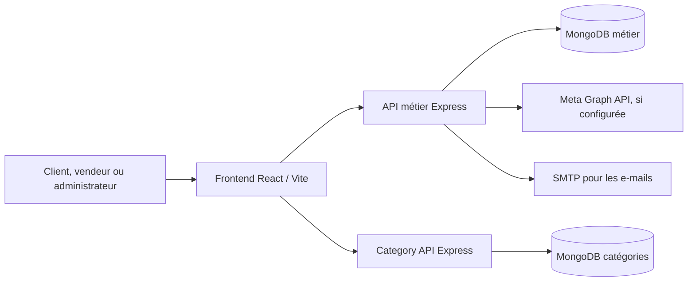

# ShopInMada

**Marketplace e-commerce pour les boutiques locales de Madagascar.** ShopInMada réunit une vitrine destinée aux clients, un espace de gestion pour les vendeurs, une console d’administration et deux API métier indépendantes.

> Ce README présente le projet pour une documentation technique et un portfolio. Les chiffres d’usage, revenus, volumes de commandes et résultats commerciaux ne sont pas publiés ici, car ils doivent être fournis à partir de données vérifiées.

## Présentation portfolio

### Le problème

Les petites boutiques ont souvent besoin de plusieurs outils pour présenter leurs produits, gérer leur catalogue et leurs commandes, suivre les paiements et garder le contact avec leurs clients. Les parcours d’achat, la gestion des vendeurs et l’administration de la plateforme sont alors dispersés, tandis que l’ajout de produits et le suivi de commandes peuvent manquer de clarté.

### La solution

ShopInMada est une marketplace qui rassemble la découverte et l’achat de produits dans une interface client, la gestion d’une boutique et de ses opérations dans un espace vendeur, et des outils de contrôle dans un espace d’administration. Une API de catégories distincte permet de gérer un catalogue hiérarchique, séparément de l’API métier principale.

### Rôle et périmètre

- **Rôle :** conception et développement logiciel d’une plateforme marketplace, de ses interfaces web à ses API, données et configurations de déploiement.
- **Périmètre :** frontend client et vendeur, console admin, API principale, API de catégories, intégration Meta Graph configurable et déploiement conteneurisé.
- **Publics :** acheteurs, vendeurs, administrateurs et opérateurs de la plateforme.
- **État :** application connectée à une architecture de déploiement VPS. Le statut de chaque intégration externe dépend de sa configuration et de ses accès de production.

### Fonctionnalités à présenter

**Expérience client**

- Parcours marketplace : accueil, recherche, filtres, catégories, boutiques, détail produit et panier.
- Comptes clients, profil et préférences de langue et de devise.
- Suivi de commande et historique regroupant les états utiles à l’achat.
- Adresses sauvegardées, favoris et produits récemment consultés.
- Avis liés à un achat vérifié.

**Espace vendeur**

- Gestion de la boutique, du catalogue et des variantes produit.
- Téléversement et optimisation des images produit côté serveur.
- Gestion des commandes, des informations de paiement et des paramètres de boutique.
- Affichage du forfait, des quotas et de l’éligibilité à la publication.
- Publication soumise à approbation et visibilité contrôlée selon l’état de la boutique et de son accès commercial.

**Espace administration**

- Gestion des comptes, des rôles admin et de leurs permissions.
- Vue vendeur consolidée : activité de la boutique, publications, commandes, KYC et abonnement.
- Modération des produits et avis, y compris traitement par lot.
- Gestion des plans, règles d’accès et opérations liées aux abonnements.
- Gestion des tickets support, des litiges, des dossiers KYC et des catégories.
- Journal d’audit et exports opérationnels selon les permissions.
- Authentification renforcée par code à usage unique pour les opérations sensibles.
- Connexion Meta Graph configurable pour sélectionner une Page Facebook et publier des produits lorsque l’application Meta, les autorisations et la Page sont correctement configurées.

**Commandes et finances**

- Suivi des changements d’état et des informations de livraison.
- Factures visibles et téléchargeables dans l’espace client lorsqu’elles sont disponibles pour la commande.
- Registre administratif des commissions, remboursements et montants à reverser.
- Les écritures financières de la plateforme ne remplacent pas le transfert effectif d’argent : les remboursements et reversements doivent être exécutés auprès du prestataire de paiement concerné.

### Résultats métier visés

- Rassembler les principaux parcours marketplace et opérations de boutique dans un seul produit.
- Donner aux vendeurs un moyen structuré de gérer produits, commandes et abonnement.
- Donner à l’administration des contrôles d’accès, de modération et de traçabilité.
- Réduire les erreurs de saisie et clarifier les refus de publication et d’envoi d’images.
- Séparer le service de catégories pour faciliter sa maintenance et son réemploi.

Ces éléments décrivent les objectifs et capacités du logiciel; ils ne constituent pas des mesures de croissance, de chiffre d’affaires ou de conversion.

## Architecture du dépôt

| Dossier | Projet | Responsabilité principale | Documentation |
| --- | --- | --- | --- |
| [`frontend/`](frontend/README.md) | Application web React | Marketplace client, comptes et espaces vendeur/admin | [README frontend](frontend/README.md) |
| [`backend/`](backend/README.md) | API métier Express | Authentification, utilisateurs, boutiques, produits, commandes, support et administration | [README backend](backend/README.md) |
| [`categoryAPI/`](categoryAPI/README.md) | API REST de catégories | Catalogue hiérarchique et recherche des catégories | [README Category API](categoryAPI/README.md) |
| [`deploy/`](deploy) | Déploiement et automatisation | Fichiers et workflows de livraison, selon les dépôts applicatifs | — |



## Technologies

| Domaine | Technologies |
| --- | --- |
| Frontend | React 18, TypeScript, Vite, Tailwind CSS, React Router |
| API principale | Node.js, Express 4, TypeScript, Mongoose |
| API de catégories | Node.js, Express 4, TypeScript, Mongoose |
| Données | MongoDB |
| Sécurité applicative | Sessions par jetons/cookies, validation serveur, protection CSRF, CORS, assainissement des entrées et permissions par rôle |
| Images | Multer et Sharp pour réception, normalisation et conversion des images produit |
| Livraison | Docker, Docker Compose, GHCR, GitHub Actions et reverse proxy Nginx sur VPS |
| Intégration sociale | Meta Graph API / OAuth, si les identifiants et autorisations Meta sont configurés |

## Points techniques et défis résolus

- **Architecture multi-application :** séparation entre interface web, API métier et service de catégories, avec contrats HTTP distincts.
- **Contrôle des accès :** rôles vendeur, admin et super admin, permissions administratives ciblées et vérification côté serveur.
- **Opérations sensibles :** demande de confirmation renforcée pour certaines actions d’administration et journalisation des changements.
- **Catalogue exploitable :** recherche, filtres, pagination serveur et règles de publication associées au statut du vendeur et à son forfait.
- **Import d’images :** prise en charge de formats d’image usuels, validation, normalisation WebP, limites de taille et erreurs plus explicites pour les refus côté API ou proxy.
- **Cycle commercial vendeur :** forfaits, accès gratuit configurable, quotas et règles de visibilité après expiration.
- **Expérience multi-appareil :** adaptations mobiles pour les interfaces marketplace et les consoles de gestion, avec attention à la navigation et aux débordements horizontaux.
- **Déploiement progressif :** images de conteneur et healthchecks permettant de valider les services avant leur routage public par Nginx.

## Projet 1 — Frontend ShopInMada

Interface web qui relie la vitrine marketplace aux services métier. Elle propose des vues adaptées aux clients, vendeurs et administrateurs, avec des parcours différents selon le rôle.

**Problèmes traités :** rendre la découverte et l’achat de produits accessibles sur mobile; guider les vendeurs dans la gestion de catalogue; fournir une interface de gestion plus lisible pour les opérations administratives; signaler les erreurs de validation et d’upload de façon exploitable.

**Technologies :** React 18, TypeScript, Vite, Tailwind CSS, React Router.

**Points portfolio :** architecture de composants et routes, formulaires métier, gestion d’état et de session, responsive design, internationalisation, intégration d’API, téléversement d’images et tableaux de bord par rôle.

Voir [`frontend/README.md`](frontend/README.md).

## Projet 2 — API métier ShopInMada

API centrale utilisée par les interfaces pour les comptes, boutiques, produits, commandes, abonnements, support et opérations d’administration.

**Problèmes traités :** centraliser les règles métier; protéger les fonctions selon les rôles et permissions; rendre les opérations sensibles auditables; gérer les limites de forfait et la visibilité des produits; traiter les images et les erreurs d’envoi; fournir les données nécessaires au suivi des commandes et aux opérations admin.

**Technologies :** Node.js, Express, TypeScript, MongoDB/Mongoose, Multer, Sharp.

**Points portfolio :** conception d’API REST, middleware d’authentification et de validation, contrôle d’accès, modèles MongoDB, cycle d’abonnement, sécurité des téléversements et intégration OAuth/Meta configurable.

Voir [`backend/README.md`](backend/README.md).

## Projet 3 — Category API (open source)

Service REST indépendant consacré au catalogue hiérarchique des catégories, réutilisable séparément de la marketplace.

**Problèmes traités :** éviter de coupler la gestion des catégories au cœur de l’API marketplace; permettre les recherches et relations parent/enfant; initialiser un catalogue depuis un jeu de données; laisser le propriétaire de l’instance choisir la protection des routes d’écriture.

**Technologies :** Node.js, Express, TypeScript, MongoDB/Mongoose.

**Points portfolio :** découpage en service autonome, conception de routes REST, données hiérarchiques, démarrage initial à partir d’un dataset et documentation de configuration.

**Licence :** le README du sous-projet indique qu’il est destiné à être open source, mais qu’aucun fichier `LICENSE` n’est présent actuellement. Ajouter une licence explicite avant d’annoncer des permissions précises de réutilisation.

Voir [`categoryAPI/README.md`](categoryAPI/README.md).

## Installation locale

Prérequis : Node.js et npm, MongoDB accessible, ainsi qu’un serveur SMTP pour les fonctions d’e-mail. Chaque application se configure et se lance séparément. Créez les fichiers `.env` à partir des `.env.example` présents dans les sous-projets et utilisez uniquement des secrets locaux.

```powershell
Copy-Item backend/.env.example backend/.env
Copy-Item categoryAPI/.env.example categoryAPI/.env
Copy-Item frontend/.env.example frontend/.env
```

Dans trois terminaux depuis la racine du dépôt :

```powershell
Set-Location backend
npm install
npm run dev
```

```powershell
Set-Location categoryAPI
npm install
npm run dev
```

```powershell
Set-Location frontend
npm install
npm run dev
```

Ports locaux par défaut : API métier `3000`, Category API `3001`; Vite affiche l’adresse du frontend au démarrage. Configurez `REACT_API_URL` et `REACT_API_CATEGORY_URL` côté frontend. Ne mettez jamais de secret dans les variables embarquées dans le bundle web.

## Compilation

```sh
cd frontend && npm run build
cd backend && npm run build
cd categoryAPI && npm run build
```

Les instructions spécifiques et variables nécessaires figurent dans les README des trois applications. Les configurations Meta et de déploiement VPS sont détaillées dans [`META_GRAPH_SETUP.md`](META_GRAPH_SETUP.md) et les fichiers de déploiement existants.

## Déploiement et exploitation

Le déploiement documenté utilise Docker Compose et des images GHCR, avec MongoDB et Nginx fournis par le VPS. Les API et le frontend ont des healthchecks; Nginx route ensuite le trafic public vers les services. Consultez la section **Déploiement VPS et CI/CD** dans la documentation opérationnelle précédente ou les workflows présents dans les dépôts applicatifs avant une mise en production.

Variables et accès de production doivent être stockés sur le serveur ou dans le gestionnaire de secrets CI, jamais dans ce dépôt. Sauvegardez les bases MongoDB et les fichiers téléversés; vérifiez la configuration Nginx et les limites de requête pour les uploads.

## Fiche prête à copier dans un portfolio

**ShopInMada — Marketplace multi-vendeurs**  
Conception et développement logiciel d’une marketplace pour les boutiques locales de Madagascar. La plateforme regroupe la découverte de produits, les comptes clients, la gestion vendeur, le suivi de commandes et une console d’administration. J’ai développé un frontend React/TypeScript, une API métier Express/MongoDB et un service autonome de catégories. Le projet traite notamment le contrôle d’accès par rôle, les abonnements et quotas vendeurs, la modération, les images produit, les opérations admin auditables et le déploiement Docker sur VPS.

**Stack :** React · TypeScript · Vite · Tailwind CSS · Node.js · Express · MongoDB · Docker · Nginx.

**À compléter avant publication :** URL publique et captures d’écran autorisées, période du projet, rôle exact, taille de l’équipe, statut des fonctionnalités Meta en production, métriques vérifiées (utilisateurs, boutiques, commandes, disponibilité) et accord du client pour présenter le projet.

## Utilisation et droits

Les projets `frontend` et `backend` sont des projets client privés. Leur réutilisation, redistribution ou republication nécessite l’autorisation écrite du détenteur des droits. `categoryAPI` est destiné à être open source, mais son dépôt ne contient pas encore de fichier de licence; le statut juridique de réutilisation doit donc être clarifié par l’ajout d’une licence.

## Contact

**Avotra Frederic** · FullCoding — Lead Developer  
Software Engineering · Applications web & mobiles · Backend & Software Architecture · Automation & AI

[GitHub](https://github.com/avotra-frederic) · [LinkedIn](https://linkedin.com/in/avotra-frederic) · [fred.avotra@gmail.com](mailto:fred.avotra@gmail.com)
